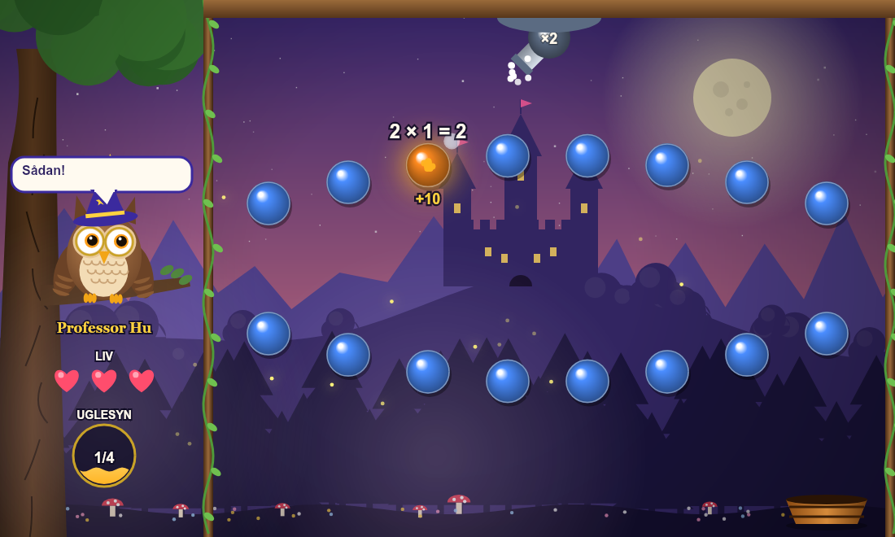
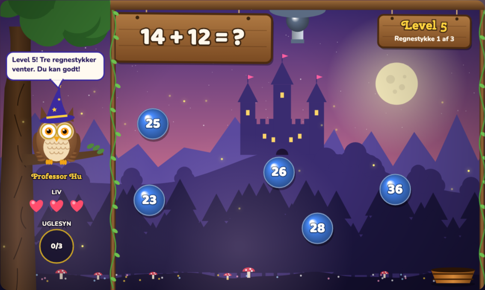
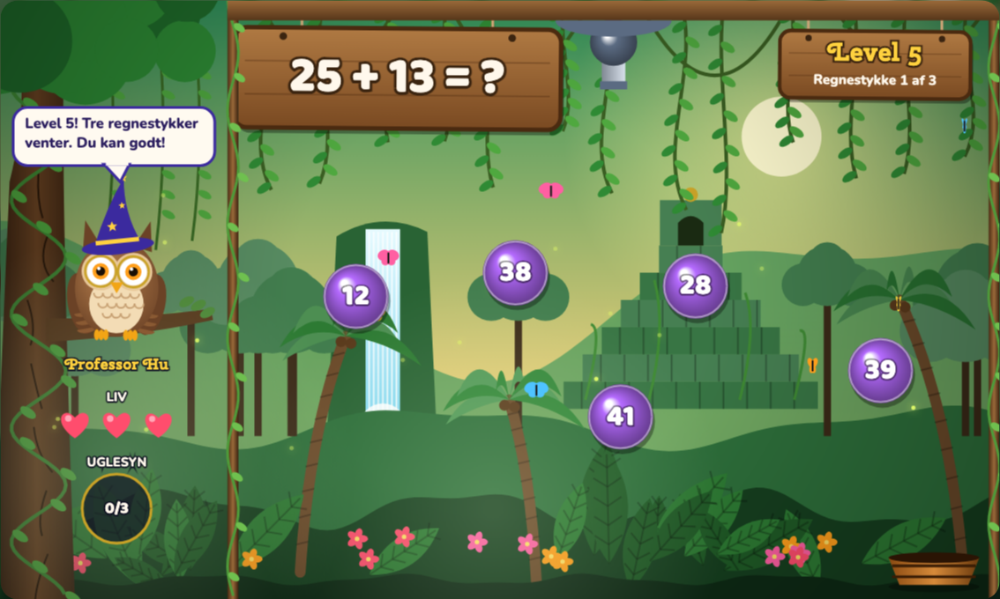
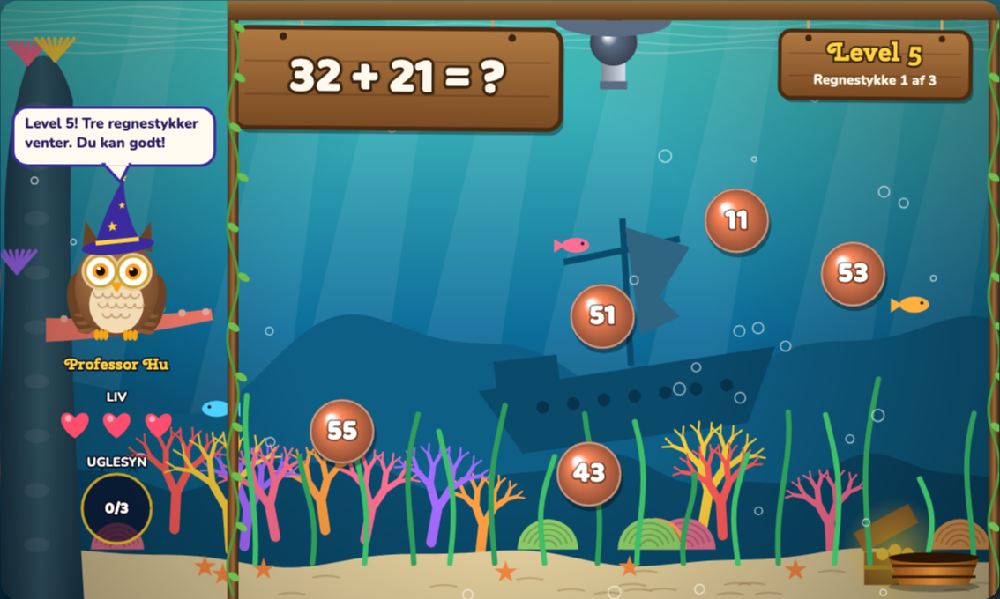
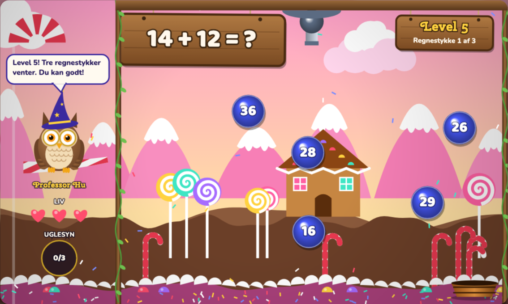
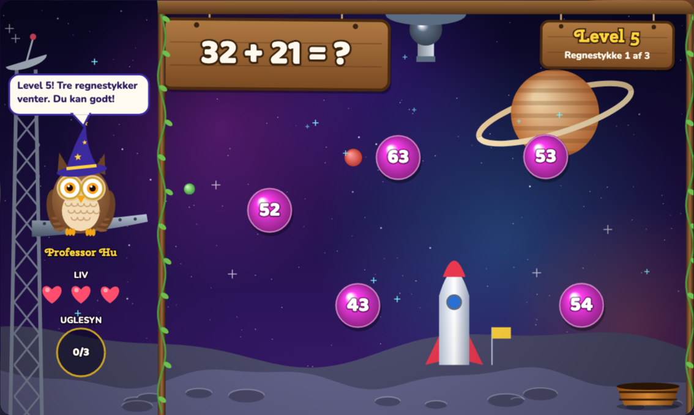

# Regnekanonen

Et lærerigt sigte-og-skyd-spil i en eventyrskov med 20 levels i plus, minus og lidt gange til indskolingen (7–8 år).

## Sådan spiller man
- Hvert level har 3 regnestykker. De kommer ét ad gangen i tilfældig rækkefølge.
- Til hvert regnestykke er der 5 svarkugler, der kører frem og tilbage og hopper på væggene og på hinanden. Sigt med musen (eller piletasterne), og klik for at skyde kuglen med det rigtige svar. Kuglerne bliver hurtigere i de højere levels. Skyder du forbi, sker der ikke noget.
- **Hylder:** Fra level 3 hænger der hylder over banerne (en træstamme, en koralhylde, en chokoladebar eller en rumbjælke alt efter verden). Svarkuglerne kører ind under dem, og din kugle hopper af dem, så skyd via væggen for at ramme en kugle under en hylde.
- **Bandeskud:** Sigtelinjen viser, hvor kuglen rammer en væg eller forhindring, og hvilken vej den hopper. Hopper kuglen, før den rammer det rigtige svar, får du 25 bonuspoint per hop.
- Tre forkerte svar, og du starter levelet forfra. Du får 1–3 stjerner pr. level.
- Uglen **Professor Hu** giver tips. To rigtige svar fylder uglens månekugle, og så kan du klikke på uglen eller UGLESYN-måleren. Uglen skyder månestråler, der fjerner to forkerte svar. Har du kun ét liv tilbage, hjælper uglen af sig selv.
- Rammer kuglen spanden i bunden, får du 25 bonusmønter. Brug mønterne i butikken på farvetemaer, kugler og kanoner.

## Sværhedsgrad
Lavet til indskolingen (7–8 år). Det stiger langsomt og holder sig mest inden for 20.

| Level | Indhold | Eksempel |
|---|---|---|
| 1–3 | Plus op til 10 | 4 + 3 |
| 4–5 | Minus op til 10 | 7 − 3 |
| 6 | Plus og minus blandet | 9 − 5 |
| 7 | Tiervenner | 6 + 4 |
| 8–9 | Plus op til 20, også over 10 | 8 + 5 |
| 10–11 | Minus op til 20, også over 10 | 13 − 5 |
| 12 | Dobbelt-op | 7 + 7 |
| 13 | Hele tiere | 30 + 20 |
| 14–16 | Tocifret uden mente | 23 + 4, 28 − 5, 35 + 20 |
| 17–18 | Gange med 2, 5 og 10 | 2 × 3 |
| 19–20 | Det hele blandet | 34 + 12 |

Regnestykkerne står i listen `LEVELS` i `index.html` og er nemme at ændre.

## Verdener i butikken
Hvert farvetema er sin egen verden med egne ting, der bevæger sig:

| Eventyrnat | Junglen | Havbund |
|---|---|---|
|  |  |  |
| Slot, fyrreskov, ildfluer | Tempel, vandfald, palmer, lianer, sommerfugle | Sunket skib, koraller, tang, fisk, bobler |

| Slikland | Rummet |
|---|---|
|  |  |
| Peberkagehus, slikkepinde, krymmel | Ringplanet, raket, månekratere, stjerneskud |

## Kør spillet
Åbn `index.html` i en browser. Der skal ikke installeres noget.
